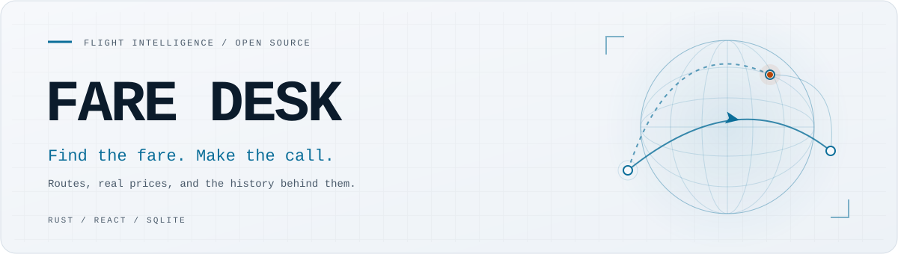

<p align="center">
  
</p>

<h1 align="center">Fare Desk</h1>
<p align="center">A flight finder and fare-intelligence workbench, built with Rust and React.</p>

<p align="center">
  <a href="https://github.com/dotkoms/Fare-Desk/actions/workflows/ci.yml"></a>
  <a href="app/Cargo.toml"></a>
  <a href="app/web/package.json"></a>
  <a href="LICENSE"></a>
  <a href="#project-status"></a>
</p>

<p align="center">
  <a href="#quickstart">Quickstart</a> ·
  <a href="#whats-built">What's built</a> ·
  <a href="#architecture">Architecture</a> ·
  <a href="#field-guide">Field guide</a> ·
  <a href="#roadmap">Roadmap</a> ·
  <a href="#contributing">Contributing</a>
</p>

---

**Find flights, compare the full trip cost, and see the history behind a buy-or-wait decision.**

Fare Desk combines a map-based flight-search interface, a Rust data plane, and a research library
for paying less for planes, trains and coaches. The application currently focuses on flights:
search results, flexible dates, fare history, airport access and source provenance. Booking
happens on the provider's site.

The application code is open source. Fare data and some data assets have separate terms; see
[licensing](#licence).

## Project status

**Functional prototype. Active development.**

The React interface and Rust API run as separate services. The web app has no fallback fare
data: if the API is unavailable, it shows an error. Search adapters are implemented for Kiwi.com
and Skiplagged's public MCP endpoints without a project-supplied API key; SerpAPI is an optional
keyed source. Availability, prices and coverage depend on the upstream service.

History-based advice needs enough collected observations. Bag fees can be estimates, return
results currently combine two one-way searches, and email delivery needs an external sender.
The API has no built-in authentication; put it behind a suitable gateway before public exposure.
See the [application guide](app/README.md) and [dated source audit](docs/25-data-sources-status.md)
for behavior and coverage details.

## What's built

| Component | Current capability |
| --- | --- |
| Flight search | Kiwi.com and Skiplagged MCP adapters, deduplication, party/bag pricing and provider redirects; optional SerpAPI. |
| Map interface | React and MapLibre interface for routes, search and itinerary results. |
| Flexible dates | A per-day fare calendar backed by Skiplagged; prices remain indicative. |
| Fare intelligence | Collected daily minima, route percentiles, seasonality and fare weather. Buy/wait advice stays insufficient below 14 observations. |
| Trip context | Curated airport access, live routing adapters and door-to-door totals; availability varies by airport and region. |
| Reliability | BTS ingestion and route/carrier on-time summaries when the relevant data has been imported. |
| Point-of-sale screening | An API for comparing shortlisted itineraries across markets, with FX, payment eligibility and explicit limits. |
| Price watches | Threshold/new-low evaluation, quiet hours, weekly caps and a JSON digest outbox; no bundled SMTP sender. |
| Provenance and operations | Source/freshness metadata, SQLite history and quota tracking, caching, rate limiting and a containerized API. |
| Research library | Sourced buying tactics, access notes and specialist agent instructions across air, rail, coach and awards. |

## Quickstart

You need Rust/Cargo and Node.js/npm. CI uses Node.js 22. Docker Compose is an alternative for
the API; the web interface runs separately.

```sh
git clone https://github.com/dotkoms/Fare-Desk.git
cd Fare-Desk
```

Start the data plane in one terminal:

```sh
cd app
cargo run -p faredesk-api
# API: http://127.0.0.1:8080
```

Start the web interface in another terminal, from the repository root:

```sh
cd app/web
npm ci
npm run dev
# Open the local URL printed by Vite.
```

Or start the API with persistent SQLite storage through Compose:

```sh
# From the repository root; this starts the data plane.
docker compose up --build
```

Optional source settings live in [`app/.env.example`](app/.env.example). The default fare
adapters need outbound internet access. Source failures, stale cached answers and exhausted
quotas are reported explicitly. See [API setup and endpoints](app/README.md) for configuration,
collection jobs and deployment details.

## Architecture

```text
React + MapLibre interface
          │  Vite proxy in local development
          ▼
Rust / Axum API
          ├── Fare adapters → normalize → deduplicate → rank
          ├── SQLite → quota ledger, fare history, watches
          └── Reference/context adapters → source + freshness metadata

Scheduled jobs → daily fare minima → route intelligence + alert outbox
```

The price path is deterministic application code. Source records keep provenance and freshness
attached; language models are not responsible for pricing or ranking.

```text
Fare-Desk/
├── app/               Rust data plane, collector jobs and React interface
├── docs/              Research, product plans, design and source records
├── agents/            Specialist agent instructions
├── data/              Watchlist templates
└── PLAN.md            Product direction and build plan
```

## Field guide

The research library covers more transport modes than the current application. Its original
research snapshot is **22 October 2026**; individual files may contain later dated checks.
Access terms and deal availability need verification against the linked sources.

| If you want to… | Read |
|---|---|
| Get the six rules that explain most savings | [docs/00-short-version.md](docs/00-short-version.md) |
| Know when to buy, by mode and region | [docs/05-when-to-buy.md](docs/05-when-to-buy.md) |
| Know which apps have APIs and which need scraping | [docs/03-public-apis-vs-scraping.md](docs/03-public-apis-vs-scraping.md) |
| Read the dated deal snapshot | [docs/06-live-deals.md](docs/06-live-deals.md) |
| Run the full tactic list | [docs/04-playbook.md](docs/04-playbook.md) |
| Understand why fares behave this way | [docs/01-how-fares-are-priced.md](docs/01-how-fares-are-priced.md) |
| Build the agent fleet | [docs/08-agent-fleet.md](docs/08-agent-fleet.md) and [agents/](agents/) |
| Avoid wasting time on myths | [docs/07-myths.md](docs/07-myths.md) |
| Read the flight finder and buy/wait product plan | [PLAN.md](PLAN.md) |
| See the unique data layers and open-source playbook | [PLAN.md §10](PLAN.md#10-unique-data-and-visual-layers) and [§18](PLAN.md#18-standout-open-source-playbook) |
| Solve cold start and Explore coverage | [docs/14-cold-start-and-coverage.md](docs/14-cold-start-and-coverage.md) |
| Review web hosting on Vercel | [docs/15-hosting-on-vercel.md](docs/15-hosting-on-vercel.md) |
| Design the interface | [UI/UX](docs/16-ui-ux.md) · [design system](docs/17-design-system.md) · [colour](docs/18-color.md) |
| Add gamification without dark patterns | [docs/19-gamification.md](docs/19-gamification.md) |
| Understand users and competitors | [docs/20-users-and-competitors.md](docs/20-users-and-competitors.md) |
| Read the earlier globe implementation plan | [docs/21-globe-implementation.md](docs/21-globe-implementation.md) |
| Replace it with a 2D poster map (Nagai direction) | [docs/23-2d-poster-map.md](docs/23-2d-poster-map.md) |
| Plan the build step by step | [docs/22-build-planner.md](docs/22-build-planner.md) |
| Decide what is an API and what needs a browser | [docs/12-rust-data-layer.md](docs/12-rust-data-layer.md) |
| Check whether another storefront is cheaper | [docs/13-point-of-sale.md](docs/13-point-of-sale.md) |


If you only do three things: search the whole week and every nearby airport, run a split-ticket
check before buying rail, and price the trip door to door including bags and the hotel night
you are replacing.

<details>
<summary>Research snapshot: API or scrape?</summary>

| Mode | Public self-serve price API? | Practical answer |
|---|---|---|
| **Air** | No from Google Flights, Kayak, Skyscanner, Momondo or Hopper. Yes from paid wrappers (SerpAPI, SearchApi) and agent MCPs (Skiplagged, Kiwi) | Scrape or use a wrapper for discovery; SerpAPI/SearchApi for the quote; Duffel or the airline for booking |
| **Rail** | Schedules yes (DB Timetables, National Rail Darwin, GTFS). Fares mostly no | Operator site or a retailer for prices; `db-vendo-client` unofficially for DB |
| **Coach** | FlixBus gates prices; BlaBlaCar Bus has a free key; Omio is affiliate/B2B | Omio or BlaBlaCar deeplinks, then verify at the operator |
| **Awards** | Seats.aero has a paid API; point.me, AwardFares, ExpertFlyer do not | Seats.aero for discovery; confirm in the loyalty program |
| **Deal feeds** | Mostly no; Reddit and Telegram have APIs | Telegram/X push for speed; verify on the operator |

The full per-app matrix, including partner-only and closed services, is in [docs/03-public-apis-vs-scraping.md](docs/03-public-apis-vs-scraping.md).


</details>

## Roadmap

| Area | Next work |
| --- | --- |
| Historical coverage | Schedule the collector and expand observed route/date coverage; let the history accumulate. |
| Return pricing | Add native round-trip pricing instead of combining two one-way searches. |
| Route discovery | Add schedule-backed destinations beyond routes with recorded fare history. |
| Search breadth | Resolve connection details before expanding Skiplagged connection coverage. |
| Context in the interface | Surface more reliability, seasonality and door-to-door information already available through the API. |
| Hosting and notifications | Configure authentication/gateway controls, persistent jobs and an external mail sender for the intended environment. |

The [build planner](docs/22-build-planner.md), [source audit](docs/25-data-sources-status.md) and
[product plan](PLAN.md) retain the detailed sequence and remaining gates.

## Ground rules

- **Redirect, don't sell.** Fare Desk links to the airline, OTA or operator; it does not process payment, issue tickets, or handle changes and refunds.
- **No booking automation.** The agents find and capture; a human transacts on the provider's site.
- **Total cost or nothing.** Bags, seats, booking fees, terminal transfers and the value of time belong on every line.
- **Link to the source.** Fetching public data is one risk; republishing airline fare content is the risk that cost Skiplagged $9.4M.
- **Fares are not guaranteed until ticketed.** Mistake fares can be cancelled; “live” award results can be stale.
- **Not legal advice.** Contracts of carriage and local rules still govern your ticket.


## Licence

- **Code:** GPL-3.0. See [LICENSE](LICENSE).
- **Contributions:** CLA. See [CLA.md](CLA.md) and [CONTRIBUTING.md](CONTRIBUTING.md).
- **Name and logo:** [TRADEMARK.md](TRADEMARK.md).
- **Fare data, fee database and hosted service:** proprietary. See [DATA-LICENSE.md](DATA-LICENSE.md).
- **Documentation:** CC BY 4.0 unless a file says otherwise.
- **Security:** [SECURITY.md](SECURITY.md).

GPL-3.0 requires source when the software is distributed. It does **not** require source for a hosted service. If that network protection becomes the priority, AGPL-3.0 is the alternative licence.


## Contributing

Fare Desk is an open-source project. Read [CONTRIBUTING.md](CONTRIBUTING.md) and sign the [CLA](CLA.md) before your first pull request. If you change an access claim, note the date and the source. The data landscape moves faster than the prose.
